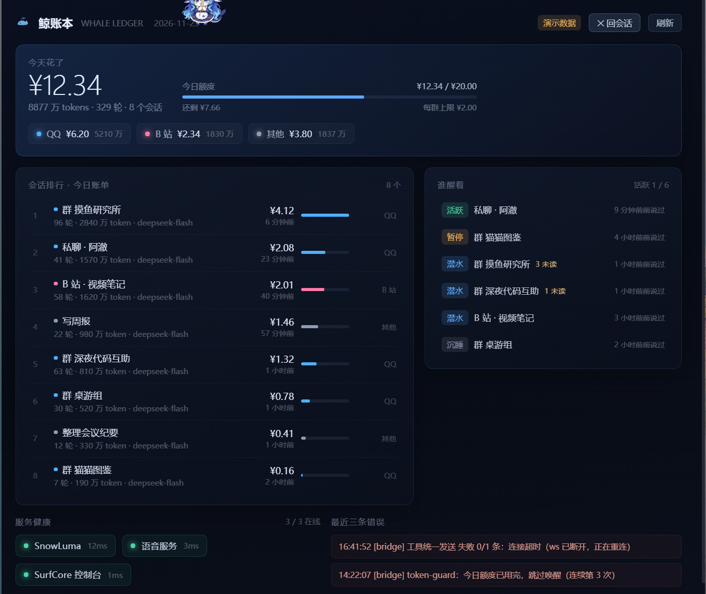
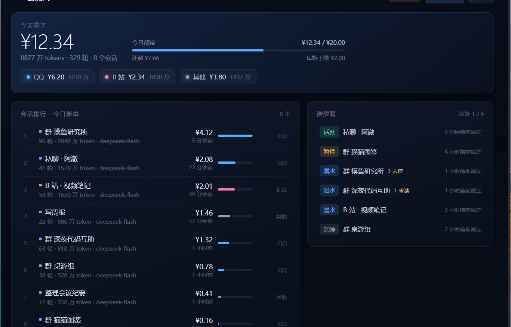
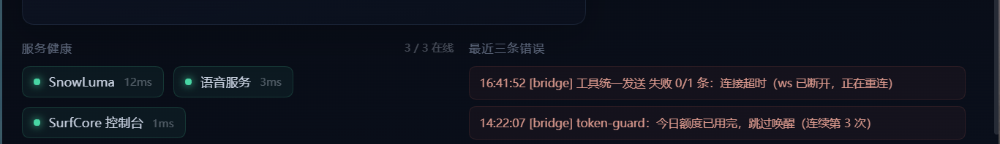

# Whale Ledger · dsh-whale-ledger

A panel for [DeepSeek Harness](https://github.com/deepseek-ai/dsh): **what you spent today, which sessions spent it, who's still awake, and whether your services are up.**

Click the little whale in the sidebar. That's it.

> Read-only. It never writes SurfCore config, session records, or secrets.

## What it shows



| Block | Content | Needs |
|---|---|---|
| **Today** | Money spent, tokens, session count; remaining budget when a limit exists | Always: DSH's own token stats |
| **Session ranking** | Per-session spend, turns, tokens for today | The above; per-session money needs SurfCore |
| **Who's awake** | Each group / DM: active, diving, sleeping or suspended (+ unread, last reply) | Optional: SurfCore |
| **Service health** | SnowLuma, voice service, console port — reachable, and how fast | Optional: addresses from SurfCore config |
| **Last three errors** | Recent error lines from `bridge.log` | Optional: SurfCore |

<table>
<tr>
<td width="58%"><br><sub>Today + ranking + who's awake: who spent what, how many turns, how many tokens</sub></td>
<td width="42%"><br><sub>Service health + last three errors</sub></td>
</tr>
</table>

> The screenshots use the demo data in `docs/demo.json` — groups, names and amounts are made up.

## Install

```powershell
cd <repo>

# installs into $DSH_HOME/profiles/desktop by default
node scripts/install.mjs --profile "$env:DSH_HOME\profiles\desktop"
```

Then **restart DSH**. Plugins mount at boot; editing files does not hot-reload.

`install.mjs` copies the folder into `node_modules`, adds one dependency and one bundle entry to the profile `package.json`, and backs that file up to `archives/` first.

**Do not use pnpm here.** The profile's `node_modules` is junctioned, so pnpm refuses with `ERR_PNPM_UNEXPECTED_VIRTUAL_STORE`. This plugin has no third party dependencies — copying the directory is enough.

Uninstall: delete `node_modules/dsh-whale-ledger` and remove the two entries from the profile `package.json`.

## Data sources

Three, plugged in only when present. A missing source **hides its block** — no errors, no empty panels.

1. **DSH itself** (always)
   - `${DSH_HOME}/storages/session_projcache/sessions/*.json` — titles, cwd, turns, cumulative tokens
   - `${DSH_HOME}/sessions/**/session.v4.jsonl.zstd` — today's events, summed from `usage` + `time` on `assistant/message`
   - The second one is only used when SurfCore is absent; results are cached in `${DSH_HOME}/whale-ledger/scan-cache.json` keyed by size + mtime.
2. **SurfCore** (optional) — resolved from `node_modules/surfcore` back to its install root: daily ledger, per-session `dayCost`, token guard limits, wake state, error log.
3. **Port probe** (optional) — TCP connect with a 700 ms timeout to the addresses in SurfCore's config.

## Degradation

- No SurfCore: money is labelled *estimate*, budget bar / per-session money / "who's awake" / errors are hidden.
- No reachable services: the health block is hidden.
- Nothing at all: a single line of explanation. Never a crash.

## Accuracy

With SurfCore installed, "today" is **exactly** `total.cost` from `token-usage-daily.json` — not recomputed, not rounded — and the per-session rows sum to that total. Without SurfCore the money is an estimate from a default price table (cache hit 0.5 / miss 3 / output 9 per million tokens), and it says so.

## Development

```powershell
node --check index.js
node --check client.js
node test/smoke.mjs     # mounts the host half on a fake ctx, asks for one snapshot
```

To look at the panel without touching real data (screenshots, demo videos), copy `docs/demo.json` to `$DSH_HOME/whale-ledger/demo.json`: the panel then shows only that data and marks itself "演示数据". Delete the file to go back immediately, no restart. `WHALE_LEDGER_DEMO=1` works too (takes effect on restart).

## Layout

```
index.js            host: reads data, computes, serves /dsh-whale-ledger
client.js           web: sidebar icon + panel (React, loaded by DSH's module loader)
cordis.patch.yml    tells DSH to mount it
scripts/install.mjs installs into a profile
test/smoke.mjs      smoke test
```

## License

MIT
