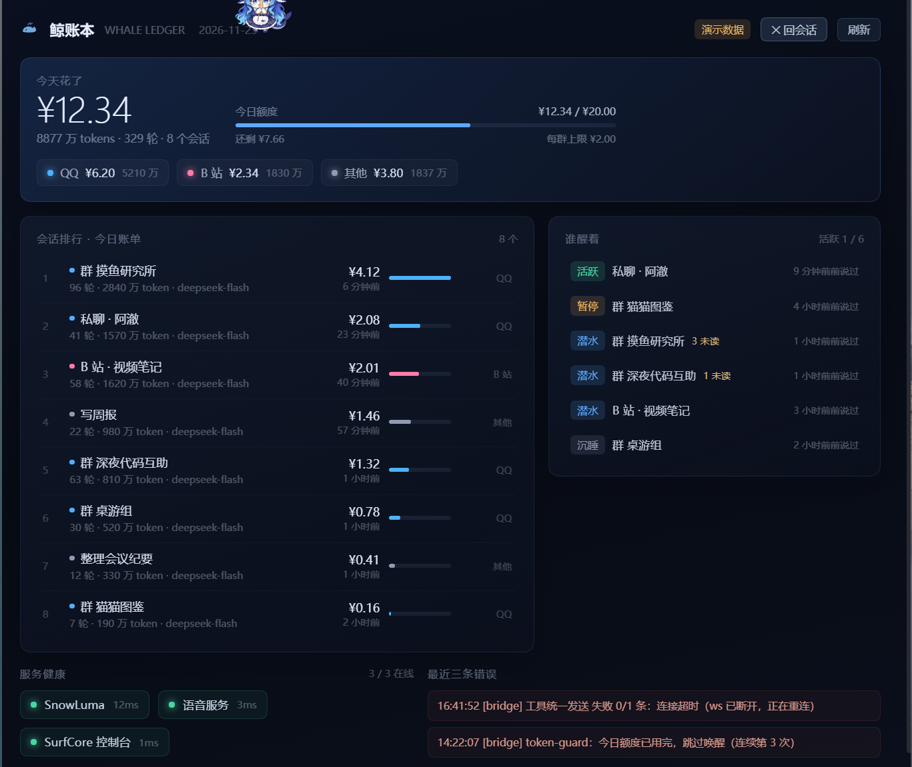
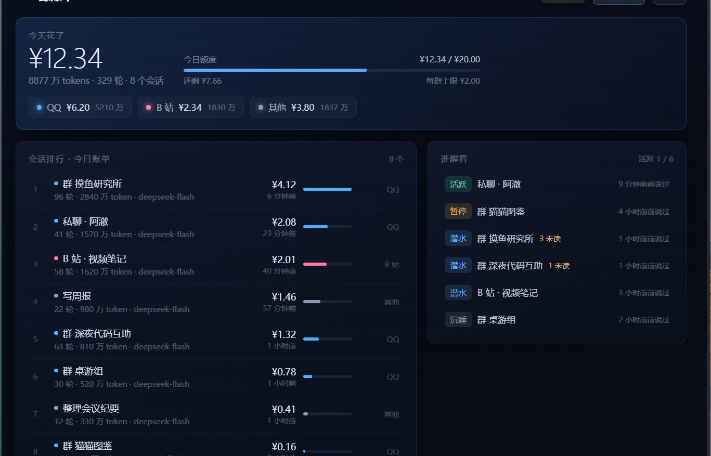
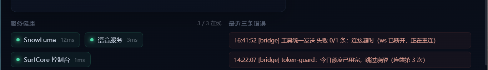

# 鲸账本 · dsh-whale-ledger


给 [DeepSeek Harness](https://github.com/deepseek-ai/dsh) 的一块面板：**今天花多少、钱花在哪个会话、谁还醒着、服务活没活。**

点侧栏那头小鲸鱼就打开。右上角「✕ 回会话」、或者直接按 Esc，就退回当前会话（不换会话、不丢草稿）。

> 只读。不写 SurfCore 的配置、不写会话记录、不写密钥。

## 它显示什么



| 块 | 内容 | 需要什么 |
|---|---|---|
| **今日** | 今天花了多少钱、多少 token、几个会话；有上限时显示「剩余额度」 | 必读：DSH 自己的 token 统计 |
| **会话排行** | 今天每个会话花了多少、几轮、多少 token | 上面这些；按会话分账要 SurfCore |
| **谁醒着** | 每个群 / 私聊现在是活跃、潜水、沉睡还是被暂停（含未读数、上次说话时间） | 可选：SurfCore |
| **服务健康** | SnowLuma、语音服务、控制台端口通不通、各多少毫秒 | 可选：SurfCore 配置里的地址 |
| **最近三条错误** | `bridge.log` 里最近的错误行 | 可选：SurfCore |

<table>
<tr>
<td width="58%"><br><sub>今日 + 会话排行 + 谁醒着：谁花得多，几轮，多少 token</sub></td>
<td width="42%"><br><sub>服务健康 + 最近三条错误</sub></td>
</tr>
</table>

> 截图用的是 `docs/demo.json` 里的演示数据：群、名字、金额都是编的，不是谁的真账。

## 装

```powershell
# 1. 把仓库放到你想放的地方，然后进目录
cd <仓库目录>

# 2. 装进 profile（默认 $DSH_HOME/profiles/desktop）
node scripts/install.mjs --profile "$env:DSH_HOME\profiles\desktop"

# 3. 重启 DSH（插件在启动时挂载，热改不生效）
```

`install.mjs` 干三件事：把目录复制进 `node_modules`、在 profile 的 `package.json` 里加一条依赖和一个 bundle 名单、改之前先把 `package.json` 备份到 `archives/`。

**不要用 pnpm。** 这个 profile 的 `node_modules` 是 Junction 进去的，pnpm 会判定 store 与 virtual-store 不一致而拒绝安装（`ERR_PNPM_UNEXPECTED_VIRTUAL_STORE`）。本插件没有第三方依赖，复制目录就够。

卸载：`node scripts/uninstall.mjs --profile "$env:DSH_HOME\profiles\desktop"`（只删目录和那两处；加 `--restore <备份的 package.json>` 可整份还原）。

## 数据源

三条，按「有没有」自己接。**没有就整块不显示**，不报错、不摆空面板。

### ① DSH 自己（人人都有，永远在）

- `${DSH_HOME}/storages/session_projcache/sessions/*.json` —— 会话标题、工作目录、轮次、累计 token
- `${DSH_HOME}/sessions/**/session.v4.jsonl.zstd` —— 今天动过的会话事件，按 `assistant/message` 上的 `usage` + `time` 累加
- 第二份只在**没装 SurfCore** 时用，用来算「今天」。会按「文件大小 + 修改时间」缓存到 `${DSH_HOME}/whale-ledger/scan-cache.json`，改过的会话才重读。

### ② SurfCore（可选）

自动从 profile 的 `node_modules/surfcore` 反查真实安装根（`.../core/plugins/surfcore` → `.../core`），读：

- `core/config.json` —— `socialV2.tokenGuard.maxDailyCostCNY` / `perGroupDailyCostCNY`
- `${DSH_HOME}/surfcore/token-usage-daily.json` —— 今天的总额（**面板上的金额就是它的原值，不重算**）
- `${DSH_HOME}/surfcore/token-usage-state.json` —— 今天每个会话的 `dayCost` / `dayTokens`
- `core/state/social-v2.json` —— `wakeConfig` / `wakeSuspendedUntil` / `lastAiReplyAt`
- `core/state/sessions.json` —— 会话 ↔ 群/私聊 对照（给会话起名用）
- `core/state/bridge.log` —— 最近三条错误

路径不对也行：插件里 `findSurfCore` 找不到就当没有。想强制关掉，给 `apply()` 传 `{ noSurfcore: true }`。

### ③ 端口探测（可选）

从 SurfCore 配置里取地址，TCP 连一下（700ms 超时）：SnowLuma（`snowluma.httpUrl`）、语音服务（`socialV2.voice.tts.baseUrl`）、控制台（`consolePort`）。

## 降级是什么样

- 没有 SurfCore：金额前标「估算」，隐藏额度条、会话分账的钱、「谁醒着」、错误列表；只留 DSH 自己的账和会话排行。
- 没有端口可用：隐藏「服务健康」。
- 一条数据源都没有（连会话缓存都读不到）：整页只剩一行说明，不崩。

## 数字准不准

装了 SurfCore 时，面板上的「今日总额」**与 `token-usage-daily.json` 的 `total.cost` 完全相等**（不重算、不四舍五入）；按会话分账加起来也等于这个总额。没装 SurfCore 时是按默认价（cache 命中 0.5 / 未命中 3 / 输出 9，元每百万 token）折出来的**估算**，会明确标出来。

## 开发

```powershell
node --check index.js
node --check client.js
node test/smoke.mjs        # 不开 DSH，把宿主挂到假 ctx 上要一次快照
```

`test/smoke.mjs` 验三件事：数字与账本一致、按会话相加等于总额、关掉 SurfCore 后仍然不报错。

想亲眼看看「没装 SurfCore」时长什么样：设 `WHALE_LEDGER_NO_CORE=1` 再重启 DSH，面板会退化成估算模式。

想不碰真实数据地看面板（截图 / 录视频）：把 `docs/demo.json` 复制到 `$DSH_HOME/whale-ledger/demo.json`，面板会只显示这份演示数据，右上角标「演示数据」；删掉这个文件立刻恢复真实数据，不用重启。也可以设 `WHALE_LEDGER_DEMO=1`（重启生效）。

改完要重新 `install.mjs` + 重启 DSH 才生效（宿主插件是启动时挂的）；只改 `client.js` 的话刷新页面就行。

## 结构

```
index.js            宿主：读数据、算数、开 /dsh-whale-ledger 路由
client.js           网页：侧栏图标 + 面板（React，运行时由 DSH 的模块加载器加载）
cordis.patch.yml    告诉 DSH「把我挂上去」
scripts/install.mjs 装进 profile
test/smoke.mjs      冒烟测试
```

## 许可

MIT
